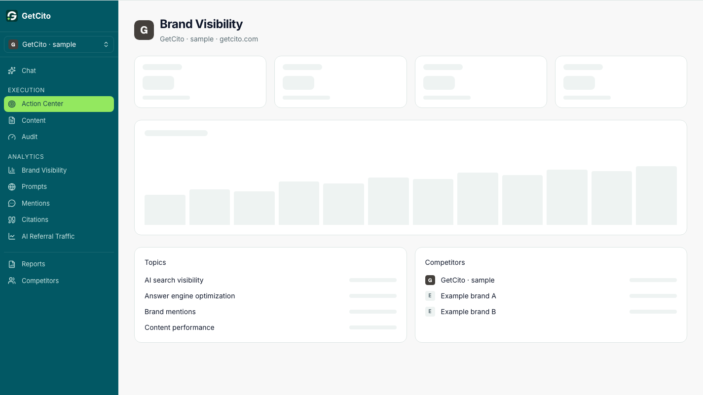

# GetCito Open Source

**Check your AI visibility. Get cited.**

An open-source platform to track and improve your brand’s presence in AI answers through AI Optimization (AIO), Answer Engine Optimization (AEO), and Generative Engine Optimization (GEO).

[Website](https://getcito.com) · [Documentation](docs/introduction.mdx) · [Issues](https://github.com/ai-search-guru/getcito-worlds-first-open-source-aio-aeo-or-geo-tool/issues) · [Support](mailto:support@getcito.com)

<picture>
  <source media="(prefers-color-scheme: dark)" srcset="docs/images/dashboard-dark.png">
  
</picture>

_Dashboard preview with sample content; metric bars are placeholders._ [Light view](docs/images/dashboard-light.png) · [Dark view](docs/images/dashboard-dark.png)

## Key features

- **AI visibility:** track prompts, brand mentions, sentiment, citations, and competitors across supported answer engines.
- **Prompt research:** organize topics, explore query fan-outs, and monitor performance over time.
- **Action Center:** turn visibility findings into prioritized tasks with evidence and outcome tracking.
- **Content and audits:** prepare briefs and drafts, audit websites, and publish approved content through configured integrations.
- **Traffic and reporting:** measure AI referrals, compare competitors, and export reports.
- **Developer access:** connect through the REST API, MCP server, webhooks, and Looker Studio connector.
- **Self-hosting:** run the application with your own database and provider accounts, with light and dark GetCito themes.

Provider coverage depends on your configuration. Product analytics and session recording are disabled; enabled AI, database, analytics, and publishing integrations still communicate with their providers.

## Built with

| Layer               | Technologies                                                |
| ------------------- | ----------------------------------------------------------- |
| Frontend            | Next.js 16, React 19, TypeScript, Tailwind CSS 4, shadcn/ui |
| Backend             | Node.js, JavaScript, Express 4, Socket.IO, node-cron        |
| Database and auth   | PostgreSQL, Supabase Auth and Storage                       |
| AI and integrations | AI SDK 6, provider adapters, Model Context Protocol         |
| Charts and editing  | Recharts, TipTap                                            |

## Getting started

You need **Node.js 24**, **npm**, **Yarn Classic (1.x)**, and a **Supabase project**. Have its project URL, anon key, and service-role key ready. AI features also require credentials for the providers you enable. Docker is only needed if you choose to run Supabase locally.

### 1. Install

```bash
git clone https://github.com/ai-search-guru/getcito-worlds-first-open-source-aio-aeo-or-geo-tool.git getcito
cd getcito

[ -f frontend/.env.local ] || cp frontend/.env.example frontend/.env.local
[ -f backend/.env ] || cp backend/.env.example backend/.env

yarn --cwd frontend install --frozen-lockfile
npm --prefix backend ci
```

If you already have this checkout, start at the environment-file commands; preserve any existing local configuration.

### 2. Prepare Supabase

For a **fresh database**, run [supabase/schema.sql](supabase/schema.sql) in the Supabase SQL Editor. For existing installations, follow the [upgrade guide](docs/self-host/upgrading.mdx) and apply pending migrations instead.

Set the Auth **Site URL** to `http://localhost:3000` and add these **Redirect URLs**:

```text
http://localhost:3000/auth/callback
http://localhost:3000/auth/confirm?next=/reset-password
```

See [database setup](docs/self-host/supabase-setup.mdx) for project configuration.

<details>
<summary>Email confirmation and password reset</summary>

For Supabase email authentication, direct the email templates to the app’s server-side confirmation route so it can set session cookies.

**Confirm signup** link:

```text
{{ .SiteURL }}/auth/confirm?token_hash={{ .TokenHash }}&type=email&next=/dashboard
```

**Reset password** link:

```text
{{ .SiteURL }}/auth/confirm?token_hash={{ .TokenHash }}&type=recovery&next=/reset-password
```

Confirm your email before signing in if email confirmation is enabled. For a deployed instance, replace the local Site URL and allowed redirects with your HTTPS domain.

</details>

### 3. Configure the environment

Set these values in the copied files, using the **same Supabase project** for both services.

**`frontend/.env.local`**

```dotenv
NEXT_PUBLIC_SUPABASE_URL=https://YOUR_PROJECT.supabase.co
NEXT_PUBLIC_SUPABASE_ANON_KEY=YOUR_ANON_KEY
SUPABASE_SERVICE_ROLE_KEY=YOUR_SERVICE_ROLE_KEY
NEXT_PUBLIC_APP_URL=http://localhost:3000
NEXT_PUBLIC_API_URL=http://localhost:8080
NEXT_PUBLIC_IS_CLOUD=false
```

**`backend/.env`**

```dotenv
PORT=8080
SUPABASE_URL=https://YOUR_PROJECT.supabase.co
SUPABASE_ANON_KEY=YOUR_ANON_KEY
SUPABASE_SERVICE_ROLE_KEY=YOUR_SERVICE_ROLE_KEY
ALLOWED_ORIGINS=http://localhost:3000
IS_CLOUD=false
```

The service-role key is required by server-side code in **both** applications. Keep it out of browser code and never give it a `NEXT_PUBLIC_` prefix.

Configure provider keys in the [frontend](frontend/.env.example) and [backend](backend/.env.example) environment files. Replace placeholder credentials and leave unused provider keys empty. The default suggestion models use Gemini (`GOOGLE_GENERATIVE_AI_API_KEY` on the backend); web answer-engine tracking uses Cloro by default. A key for a different provider does not automatically change those defaults.

For Chat, MCP actions, and citation recounts, generate a `CRON_SECRET` with `openssl rand -hex 32` and set the same value in both files. For stored provider keys, set `GETCITO_ENCRYPTION_KEY` in the frontend to a base64-encoded 32-byte key generated with `openssl rand -base64 32`. See the [environment reference](docs/self-host/env-variables.mdx) for optional services.

### 4. Run

Run these commands from the repository root, in separate terminals:

```bash
# API — http://localhost:8080
npm --prefix backend run dev
```

```bash
# Web app — http://localhost:3000
yarn --cwd frontend dev
```

Check that the API is reachable:

```bash
curl -fsS http://localhost:8080/
```

## Usage

1. Open [localhost:3000/sign-up](http://localhost:3000/sign-up) and create an account.
2. Add your brand, domain, topics, and competitors during onboarding.
3. Add prompts, select configured answer engines, and run tracking.
4. Review mentions and citations, then use the Action Center to plan improvements.

To query your brands from a script, create a key under **Settings → MCP & API Keys** and call the web app’s versioned API:

```bash
export GETCITO_API_KEY="getcito_YOUR_API_KEY"
curl -fsS http://localhost:3000/api/v1/brands \
  -H "Authorization: Bearer $GETCITO_API_KEY"
```

See the [API reference](docs/api-reference/metrics.mdx), [MCP guide](docs/guides/mcp-server.mdx), and [connectors](CONNECTORS.md) for integrations.

## Project structure

```text
frontend/      Next.js dashboard, auth, and web API routes
backend/       Express API, background jobs, and providers
supabase/      Schema, migrations, and seed data
docs/          Setup guides, API docs, and project images
help/          In-app help articles
skills/        Chat and AEO coaching skills
integrations/  External reporting connectors
scripts/       Version management
```

## Development

```bash
npm run version:check
yarn --cwd frontend lint
yarn --cwd frontend typecheck
yarn --cwd frontend test
npm --prefix backend run lint
npm --prefix backend test
```

Build the frontend with `yarn --cwd frontend build`. All application packages currently use version **9.0.0**.

[Repository banner and social preview](docs/repository-preview.md)
